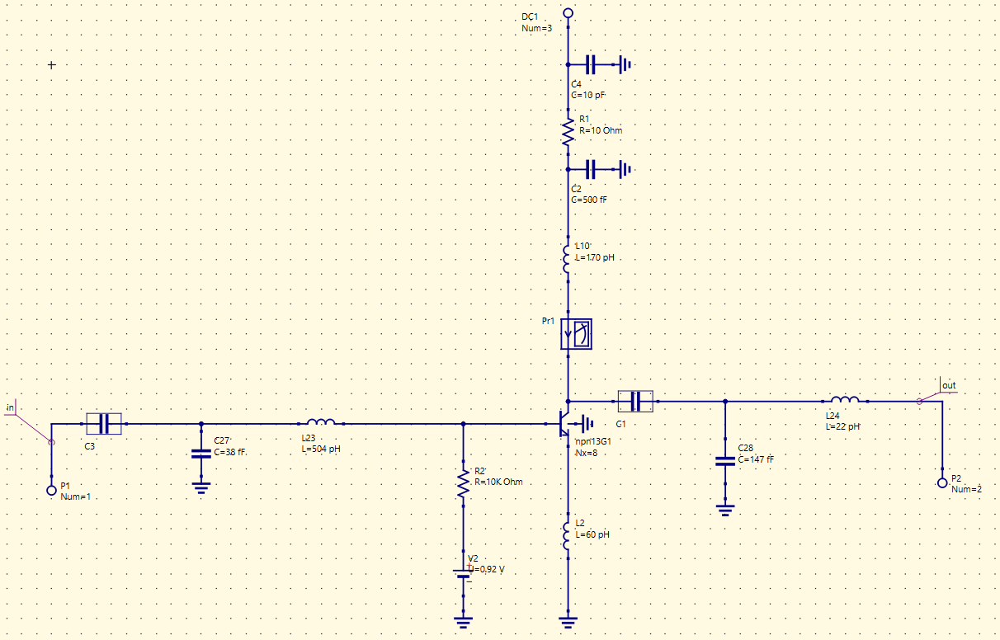

# 27 GHz RF Front-End Design Space

Simulation-based design-space generation for 27 GHz SiGe RF front-end amplifier topologies using the **IHP SG13G2 130 nm SiGe BiCMOS Open PDK**.

This repository documents the public-facing engineering workflow, selected circuit schematics, analysis setups and project methodology. The underlying parameter-performance dataset is being developed separately and **is not publicly distributed**.

## Project scope

The project studies four RF amplifier families within one consistent simulation and data-generation framework:

| Circuit family | RF role | Status |
|---|---|---|
| [Common-Emitter PA](circuits/ce_pa/) | Transmitter / power amplifier | Active dataset generation |
| [Cascode PA](circuits/cascode_pa/) | Transmitter / power amplifier | Initial baseline batch completed |
| [Common-Emitter LNA](circuits/ce_lna/) | Receiver / low-noise amplifier | Baseline small- and large-signal characterization documented |
| [Cascode LNA](circuits/cascode_lna/) | Receiver / low-noise amplifier | Planned extension |

The central idea is to vary physically meaningful circuit parameters—bias conditions, device sizing, RF choke values and matching-network components—then characterize each valid configuration through RF simulation and post-processing. These validated design-response pairs form a private structured dataset for later analysis and design-space exploration.

## Technology and workflow

- **Technology:** IHP SG13G2 130 nm SiGe BiCMOS Open PDK
- **Design frequency:** 27 GHz
- **Schematic environment:** Qucs-S
- **Small-signal / noise simulation:** ngspice
- **Large-signal / harmonic-balance simulation:** Xyce
- **Post-processing:** Python
- **Current focus:** repeatable circuit characterization and dataset generation

```text
Design parameters
      ↓
DC operating-point verification
      ↓
Small-signal / noise / stability analysis
      ↓
Matching-network verification
      ↓
Large-signal harmonic-balance analysis
      ↓
Python post-processing
      ↓
Validated private dataset row
```

## Power-amplifier branches

### Common-Emitter PA

Single-HBT common-emitter architecture with parameterized bias, device multiplier, RF choke and input/output matching networks.


Detailed schematic and analysis views: **[CE PA documentation](circuits/ce_pa/)**

### Cascode PA

Stacked common-emitter/common-base SiGe HBT architecture with independent device sizing and bias exploration, together with RF-choke and matching-network variation.


Detailed schematic and analysis views: **[Cascode PA documentation](circuits/cascode_pa/)**

## LNA branches

### Common-Emitter LNA

The CE LNA branch now includes a documented 27 GHz baseline schematic, small-signal validation and large-signal characterization.



Detailed schematic and analysis views: **[CE LNA documentation](circuits/ce_lna/)**

### Cascode LNA

The cascode LNA branch remains a planned extension and will be added as its circuit design and validation work is completed.

## Repository structure

```text
.
├── circuits/
│   ├── ce_pa/          # CE PA documentation and figures
│   ├── cascode_pa/     # Cascode PA documentation and figures
│   ├── ce_lna/         # CE LNA documentation and figures
│   └── cascode_lna/    # Planned extension
├── data/
│   └── README.md       # Private-dataset policy and schema notes
├── scripts/
│   └── README.md       # Post-processing / analysis-code organization
├── docs/
│   └── README.md       # Project-level documentation
└── README.md
```

## Data availability

The numerical design-space dataset is **private research data** and is not included in this public repository. Public materials are limited to selected schematics, analysis setups, methodology descriptions and code/documentation that can be shared without exposing the underlying dataset.

## Research direction

The immediate objective is systematic and reproducible RF circuit dataset generation rather than optimization of a single design point. As the dataset matures, it can support comparative topology analysis, surrogate modeling and ML-assisted RF design-space exploration.

## Note

All material currently shown here is **simulation-based**. Nothing in this repository should be interpreted as fabricated- or measured-silicon performance unless explicitly stated otherwise.

## Author

**Arian Rahman Aditta**  
B.Sc. in Electronics and Communication Engineering, KUET  
Research interests: RF/mmWave IC design, analog/RF ICs, VLSI/EDA and ML-assisted hardware design
