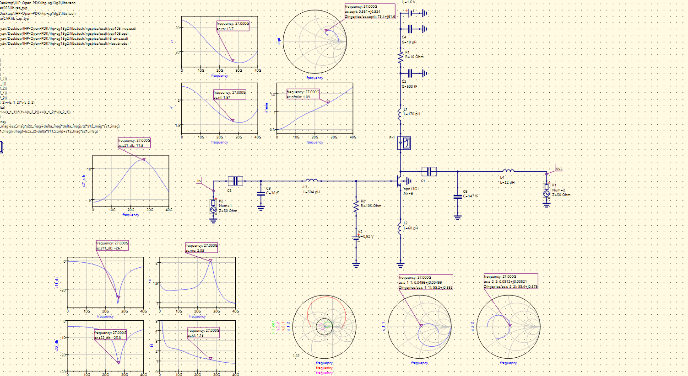
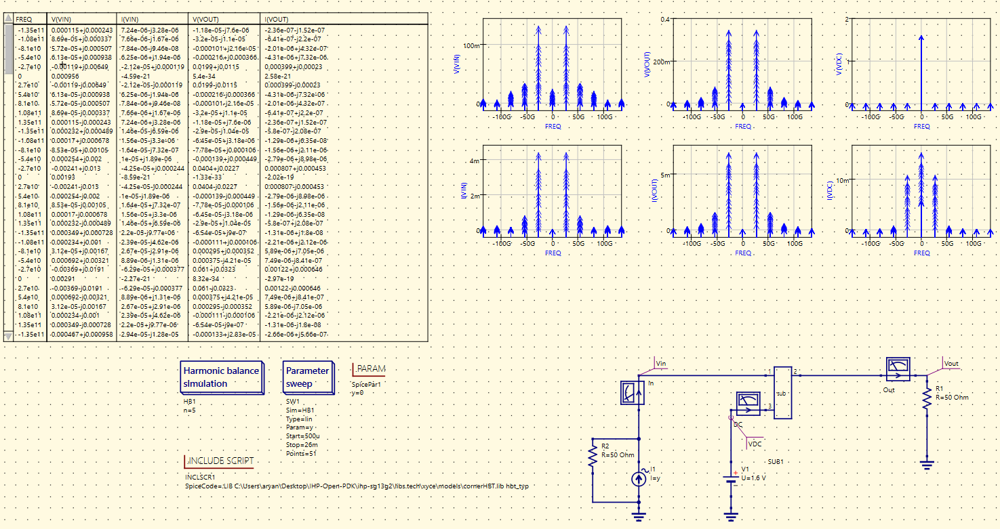
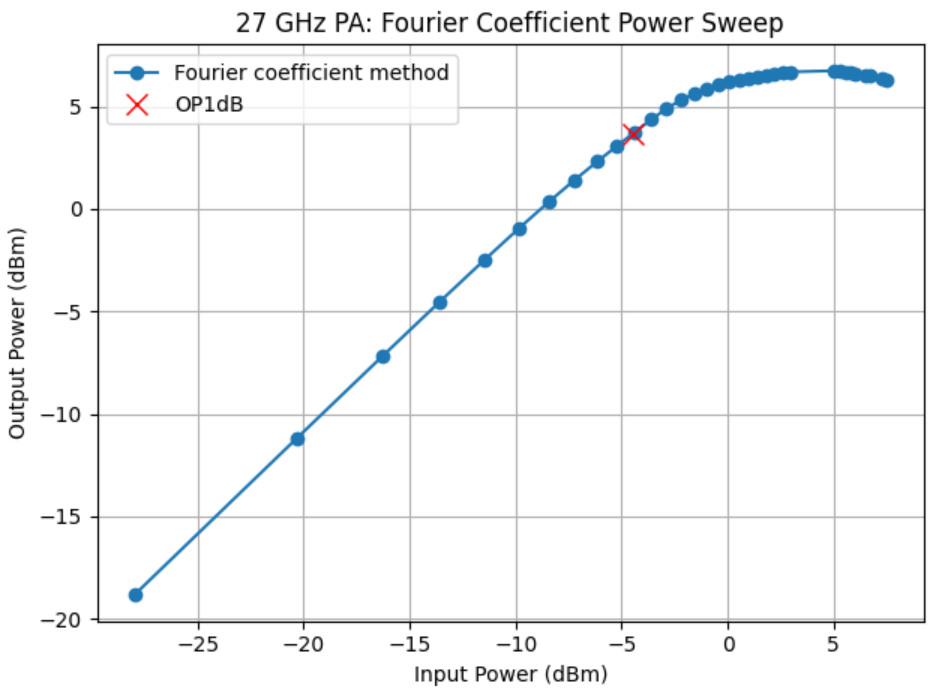
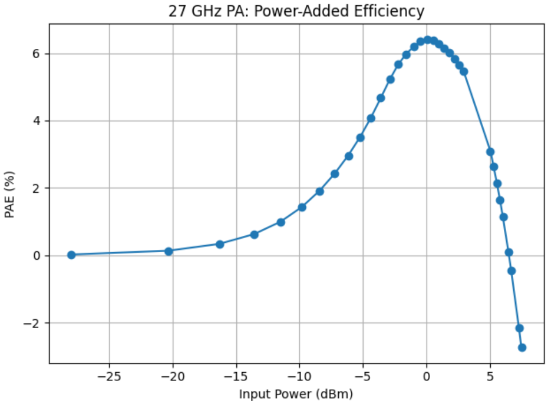

# Common-Emitter Low-Noise Amplifier (CE LNA)

27 GHz common-emitter SiGe HBT LNA implemented in Qucs-S using the IHP SG13G2 Open PDK. The branch uses inductive emitter degeneration together with input/output matching and a collector RF-choke network.

## Baseline topology

The baseline schematic includes:

- an input matching network around the selected 27 GHz operating point;
- inductive emitter degeneration for gain/noise/matching trade-offs;
- collector biasing through an RF choke and RF bypass network; and
- an output matching network referenced to 50 Ω.

## Small-signal characterization

The small-signal validation view documents the simulated gain, input/output matching, noise behavior and Smith-chart response around the 27 GHz design frequency. These results are simulation-based and are used to verify a candidate configuration before design-space sampling.

## Large-signal characterization

Large-signal harmonic-balance analysis is used to inspect spectral response and nonlinear behavior as input drive is increased.

### Output compression

The power sweep tracks output power versus input power and identifies the simulated 1 dB compression region using post-processed Fourier-coefficient data.

### Power-added efficiency

PAE is evaluated across the same large-signal sweep to document the efficiency trend as the amplifier moves from small-signal operation toward compression.

## Characterization focus

The CE LNA branch is intended for systematic design-space generation rather than presentation of a single optimized point. The public repository therefore shows selected validation views, while the numerical parameter-performance dataset remains private.
