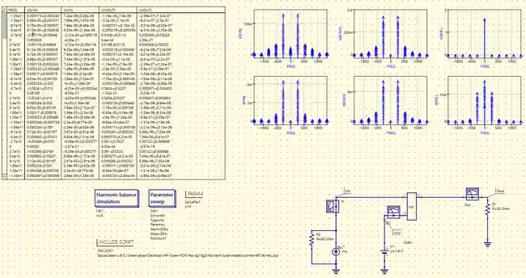
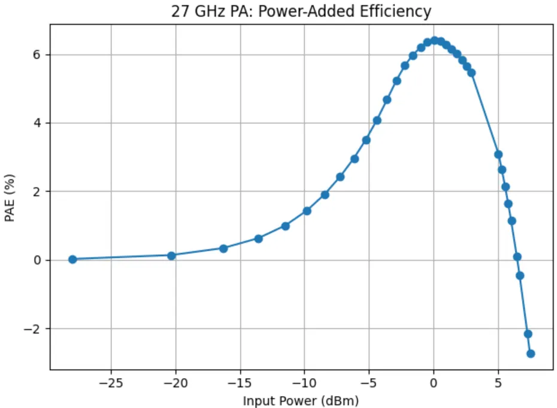

# Common-Emitter Low-Noise Amplifier (CE LNA)

27 GHz common-emitter SiGe HBT LNA implemented in Qucs-S using the IHP SG13G2 Open PDK. The branch uses inductive emitter degeneration together with input/output matching and a collector RF-choke network.

## Baseline topology

The baseline schematic includes:

- an input matching network around the selected 27 GHz operating point;
- inductive emitter degeneration for gain/noise/matching trade-offs;
- collector biasing through an RF choke and RF bypass network; and
- an output matching network referenced to 50 Ω.

## Small-signal characterization

The small-signal validation view documents the simulated gain, input/output matching, noise behavior and Smith-chart response around the 27 GHz design frequency. These results are simulation-based and are used to verify a candidate configuration before design-space sampling.

## Large-signal characterization

Harmonic-balance simulation is used to examine the nonlinear response of the same CE LNA configuration. The input-power sweep is post-processed in Python to obtain compression and efficiency trends.

### 1 dB compression

The plotted operating point marks the extracted 1 dB compression region from the Fourier-coefficient power sweep.

### Power-added efficiency

PAE is evaluated across the same input-power sweep to show the efficiency trend as the amplifier approaches and enters compression.

## Design-space role

The CE LNA branch is now part of the validated simulation workflow used for systematic parameter-performance data generation. Bias, transistor sizing, emitter degeneration, RF choke and matching-network values are varied while retaining DC, small-signal/noise, matching, stability and large-signal checks.

The numerical design-space dataset remains private; this repository contains selected schematics, analysis views and methodology only.
